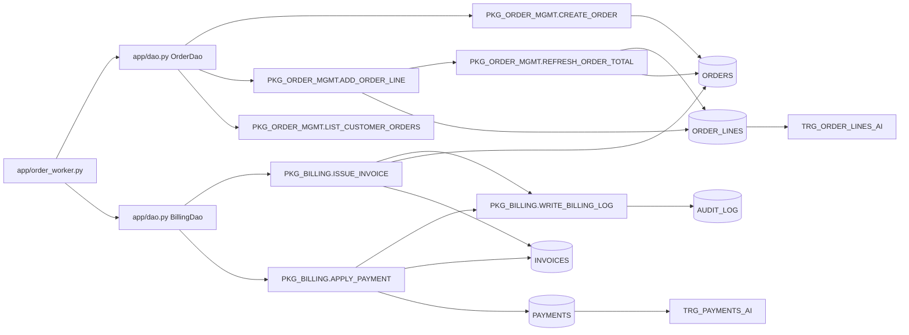

# Caller and database access map

## Findings

The included application calls five public package procedures. Two more public procedures are called only from other PL/SQL. Seven public routines have no caller in the included estate. No trigger or view calls a package routine.

This is a source-only map. The inherited note says a scheduler may call billing and that reports may use `CURRENT_ORDERS`, but neither caller is present in the repository.

## Package routine callers

| Public routine | Other PL/SQL callers | Trigger callers | View callers | Application callers | Downstream tables and triggered behavior |
|---|---|---|---|---|---|
| `PKG_ORDER_MGMT.CREATE_ORDER` | None found | None found | None found | `app/dao.py:41-48` calls it from `OrderDao.create_order`; `app/order_worker.py:10-14` reaches it through that DAO method. | Inserts `ORDERS` at `packages/pkg_order_mgmt.pkb:22-36`, firing `TRG_ORDERS_BI`; then dynamically reads `ORDERS` at lines 38-40. |
| `PKG_ORDER_MGMT.ADD_ORDER_LINE` | None found | None found | None found | `app/dao.py:50-56` calls it from `OrderDao.add_line`; `app/order_worker.py:16-22` reaches it once per payload line. | Reads and inserts `ORDER_LINES` at `packages/pkg_order_mgmt.pkb:62-84`, firing `TRG_ORDER_LINES_AI`; calls `REFRESH_ORDER_TOTAL` at line 86. |
| `PKG_ORDER_MGMT.REFRESH_ORDER_TOTAL` | `PKG_ORDER_MGMT.ADD_ORDER_LINE` at `packages/pkg_order_mgmt.pkb:86` | None found | None found | No direct application call found | Aggregates `ORDER_LINES` and updates `ORDERS` at `packages/pkg_order_mgmt.pkb:96-109`. |
| `PKG_ORDER_MGMT.LIST_CUSTOMER_ORDERS` | None found | None found | None found | `app/dao.py:58-65` calls it from `OrderDao.page_for_customer`; `app/order_worker.py:34-39` calls that DAO method; `app/order_worker.py:42-50` reaches it from the placeholder batch. | Reads `ORDERS` at `packages/pkg_order_mgmt.pkb:123-143`. |
| `PKG_ORDER_MGMT.LOAD_ORDER_TOTALS` | None found | None found | None found | None found | Deletes and inserts `GTT_ORDER_TOTALS` and reads `ORDERS` and `ORDER_LINES` at `packages/pkg_order_mgmt.pkb:154-169`. |
| `PKG_ORDER_MGMT.SUMMARIZE_ORDER` | None found | None found | None found | None found | Reads `ORDER_LINES`, `ORDERS`, and optional `INVOICES` at `packages/pkg_order_mgmt.pkb:182-209`; writes only to `DBMS_OUTPUT`. |
| `PKG_BILLING.WRITE_BILLING_LOG` | `PKG_BILLING.ISSUE_INVOICE` at `packages/pkg_billing.pkb:83`; `PKG_BILLING.APPLY_PAYMENT` at lines 143-147 | None found | None found | No direct application call found | Inserts and commits `AUDIT_LOG` at `packages/pkg_billing.pkb:12-30`, firing `TRG_AUDIT_LOG_BI`. |
| `PKG_BILLING.ISSUE_INVOICE` | None found | None found | None found | `app/dao.py:86-91` calls it from `BillingDao.issue_invoice`; `app/order_worker.py:24` reaches it through that DAO method. | Reads `ORDERS`, advances `SEQ_INVOICES`, inserts `INVOICES`, fires `TRG_INVOICES_BI`, and calls `WRITE_BILLING_LOG` at `packages/pkg_billing.pkb:46-83`. |
| `PKG_BILLING.APPLY_PAYMENT` | None found | None found | None found | `app/dao.py:93-99` calls it from `BillingDao.take_payment`; `app/order_worker.py:25-30` reaches it when a payment exists. | Locks and updates `INVOICES`, reads and inserts `PAYMENTS`, fires `TRG_PAYMENTS_AI`, and calls `WRITE_BILLING_LOG` at `packages/pkg_billing.pkb:105-147`. |
| `PKG_BILLING.REBUILD_INVOICE_TOTALS` | None found | None found | None found | None found | Reads and updates `INVOICE_LINES` and updates `INVOICES` at `packages/pkg_billing.pkb:165-183`. |
| `PKG_CUSTOMER_HIER.PRINT_TREE` | None found | None found | None found | None found | Traverses `CUSTOMERS` at `packages/pkg_customer_hier.pkb:7-22`; writes only to `DBMS_OUTPUT`. |
| `PKG_CUSTOMER_HIER.LIST_ANCESTORS` | None found | None found | None found | None found | Traverses `CUSTOMERS` and returns a ref cursor at `packages/pkg_customer_hier.pkb:30-35`. |
| `PKG_CUSTOMER_HIER.FIND_UNORDERED_CUSTOMERS` | None found | None found | None found | None found | Reads `CUSTOMERS` and `ORDERS` at `packages/pkg_customer_hier.pkb:42-50`. |
| `PKG_CUSTOMER_HIER.DESCENDANT_COUNT` | None found | None found | None found | None found | Traverses and counts `CUSTOMERS` at `packages/pkg_customer_hier.pkb:58-68`. |

## Trigger and view caller result

Searches of all trigger and view source found no reference to `PKG_ORDER_MGMT`, `PKG_BILLING`, `PKG_CUSTOMER_HIER`, or any public routine name. Triggers are downstream effects of package DML, not callers:

| Trigger | DML paths in the included estate that can fire it |
|---|---|
| `TRG_CUSTOMERS_BI` | No included package or Python insert; an external loader is implied but not present. |
| `TRG_ADDRESSES_BI` | No included package or Python insert; an external loader is implied but not present. |
| `TRG_PRODUCTS_BI` | No included package or Python insert; an external loader is implied but not present. |
| `TRG_ORDERS_BI` | `PKG_ORDER_MGMT.CREATE_ORDER`. |
| `TRG_INVOICES_BI` | `PKG_BILLING.ISSUE_INVOICE`. |
| `TRG_ORDER_LINES_AI` | `PKG_ORDER_MGMT.ADD_ORDER_LINE`; any omitted direct insert or update of quantity, price, or discount. |
| `TRG_PAYMENTS_AI` | `PKG_BILLING.APPLY_PAYMENT`; any omitted direct payment insert. |
| `TRG_AUDIT_LOG_BI` | `PKG_BILLING.WRITE_BILLING_LOG`; any omitted direct audit insert. |

The three views read tables only. They do not invoke PL/SQL:

| View | Direct dependencies |
|---|---|
| `V_ORDER_SUMMARY` | `ORDERS`, `CUSTOMERS`, `INVOICES` |
| `V_CUSTOMER_BALANCE` | `CUSTOMERS`, `ORDERS`, `INVOICES`, `PAYMENTS` |
| `V_RECENT_ORDERS` | `ORDERS` |

The materialized view `MV_CUSTOMER_ORDER_ROLLUP` reads `CUSTOMERS` and `ORDERS`.

## Reverse map: direct application database access

This table distinguishes direct SQL from package-mediated access.

| Application file | Direct table, view, or sequence access | Package-mediated access |
|---|---|---|
| `app/__init__.py` | None | None |
| `app/dao.py` | Reads `ORDERS` and optional `INVOICES` in `OrderDao.old_summary_query` at lines 67-79. | Calls `PKG_ORDER_MGMT.CREATE_ORDER` at lines 41-48, `ADD_ORDER_LINE` at 50-56, `LIST_CUSTOMER_ORDERS` at 58-65, `PKG_BILLING.ISSUE_INVOICE` at 86-91, and `APPLY_PAYMENT` at 93-99. |
| `app/order_worker.py` | None | Through DAO methods, reaches order creation, line insertion, paging, invoice issuance, and payment application at lines 6-39 and 42-50. |
| `app/raw_queries.sql` | Reads `ORDERS`, `CUSTOMERS`, and optional `INVOICES` at lines 3-13; reads `CUSTOMERS` at 15-27; reads `ORDERS` at 29-32; advances `SEQ_ORDERS` at 34-35. | None |

No included application file selects from `V_ORDER_SUMMARY`, `V_CUSTOMER_BALANCE`, `V_RECENT_ORDERS`, `MV_CUSTOMER_ORDER_ROLLUP`, or the `CURRENT_ORDERS` synonym. Their callers are outside the supplied source, unused, or both.

## Transaction call chain in the included worker

`app/order_worker.py:6-31` creates an order, adds zero or more lines, issues an invoice, and optionally takes a payment. Commit behavior is not one transaction per business operation:

1. `OrderDao.create_order` does not commit.
2. Every `OrderDao.add_line` call commits at `app/dao.py:56`, which also commits the order and all prior lines.
3. `BillingDao.issue_invoice` commits at `app/dao.py:90`.
4. `BillingDao.take_payment` commits at `app/dao.py:99`.
5. Each billing audit call commits independently inside its autonomous transaction.

If the payload has no lines, the first application commit is invoice issuance. If a later step fails, earlier order, line, invoice, or audit commits may remain.

## Dependency diagram

## Missing caller evidence

The source cannot establish the full production call graph:

- `docs/estate-notes.md:12-13` says a scheduler appears to call `PKG_BILLING`, but its definition is absent.
- `docs/estate-notes.md:14-15` says external reports may use `CURRENT_ORDERS`.
- `SEQ_PRICE_TIERS` and `SEQ_INVOICE_LINES` have no included caller.
- Seven public routines have no included caller, which does not prove they are unused.
- Grants, database links, scheduler jobs, other schemas, report definitions, and SQL captured from runtime are absent.
